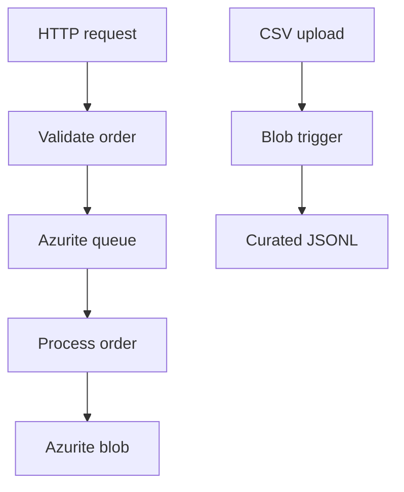

# Azure Functions with Python — local learning course

Learn Azure Functions on Windows without an Azure account, subscription, Azure CLI login, Docker, or cloud deployment.

The required learning path takes about **8 hours**. Allow up to **1 additional hour** for installation or troubleshooting. Optional exercises do not count toward completion.

The course starts with an HTTP function, then introduces timers, queues, blobs, testing, and Durable Functions. All examples use Python 3.13.15, a project-level virtual environment, Azure Functions Core Tools 4, the Python v2 programming model, and Azurite for local Azure Storage.

## What you will build



## Start here

1. [Course roadmap](docs/00-course-roadmap.md)
2. [Windows setup](docs/01-windows-setup.md)
3. [First HTTP functions](docs/02-http-functions.md)
4. [Triggers, bindings, and configuration](docs/03-core-concepts.md)
5. [Timer trigger](docs/04-timer-trigger.md)
6. [Trigger types and selection](docs/05-trigger-types.md)
7. [Azurite setup](docs/06-azurite.md)
8. [HTTP-to-queue-to-blob pipeline](docs/07-queue-pipeline.md)
9. [CSV blob processing](docs/08-blob-pipeline.md)
10. [Testing and debugging](docs/09-testing-debugging.md)
11. [Durable Functions](docs/10-durable-functions.md)
12. [Production readiness](docs/11-production-readiness.md)
13. [Use GitHub Copilot as your lab tutor](docs/12-copilot-lab-guide.md)
14. [Command cheat sheet](docs/CHEATSHEET.md)

## Fast setup

After installing Python 3.13.15, VS Code, Azure Functions Core Tools 4, and the VS Code Azurite extension:

```powershell
git clone <YOUR-REPOSITORY-URL>
cd azure-functions-python-local-course
.\scripts\setup.ps1
# In VS Code, run: Azurite: Start
.\scripts\start.ps1
```

Open <http://localhost:7071/api/health>.

No Azure account is used anywhere in this repository.

## Project structure

```text
function_app.py                 Main Functions project
storage_functions.py           Azurite-backed storage blueprint
src/                            Pure Python business logic
tests/                          Tests that do not require Azure or Azurite
tools/storage.py                Local Azurite upload and inspection helper
sample_data/                    Synthetic input data
examples/                       Reference patterns for cloud-only triggers
advanced/durable_app/           Separate Durable Functions project
scripts/                        Windows setup, start, and test scripts
docs/                           Step-by-step lessons
.github/agents/                 VS Code Copilot lab tutor
.github/copilot-instructions.md Always-on Copilot course context
.vscode/extensions.json         Recommended VS Code extensions
```

## Supported baseline

- Windows 10 or 11
- Python 3.13.15 x64
- Azure Functions Core Tools 4.x
- Python v2 programming model
- Azurite for Functions host state, Blob Storage, Queue Storage, and Durable state

Python 3.13.15 is the exact local course baseline. If you deploy later, check Python 3.13 support on Flex Consumption or a compatible Premium/Dedicated plan. Do not use legacy Linux Consumption for Python 3.13. Deployment is outside this course.

## Verification

Run the tests:

```powershell
.\scripts\test.ps1
```

The pure Python tests verify validation, money calculations, and CSV handling. The storage lessons provide manual integration checks because they require a running local Functions host and Azurite.

## Completion standard

You have completed the core course when you can:

- Run and explain HTTP and timer triggers.
- Select an appropriate trigger from the trigger catalog.
- Run the Queue and Blob examples with Azurite.
- Separate Functions adapters from testable Python logic.
- Start and inspect a Durable fan-out/fan-in workflow.
- Explain retries, idempotency, poison messages, and local-to-cloud gaps.

## Primary references

- [Develop Azure Functions locally](https://learn.microsoft.com/azure/azure-functions/functions-develop-local)
- [Python developer guide](https://learn.microsoft.com/azure/azure-functions/functions-reference-python)
- [Core Tools](https://learn.microsoft.com/azure/azure-functions/functions-run-local)
- [Azurite](https://learn.microsoft.com/azure/storage/common/storage-use-azurite)
- [Durable Functions Python quickstart](https://learn.microsoft.com/azure/azure-functions/durable/quickstart-python-vscode)
