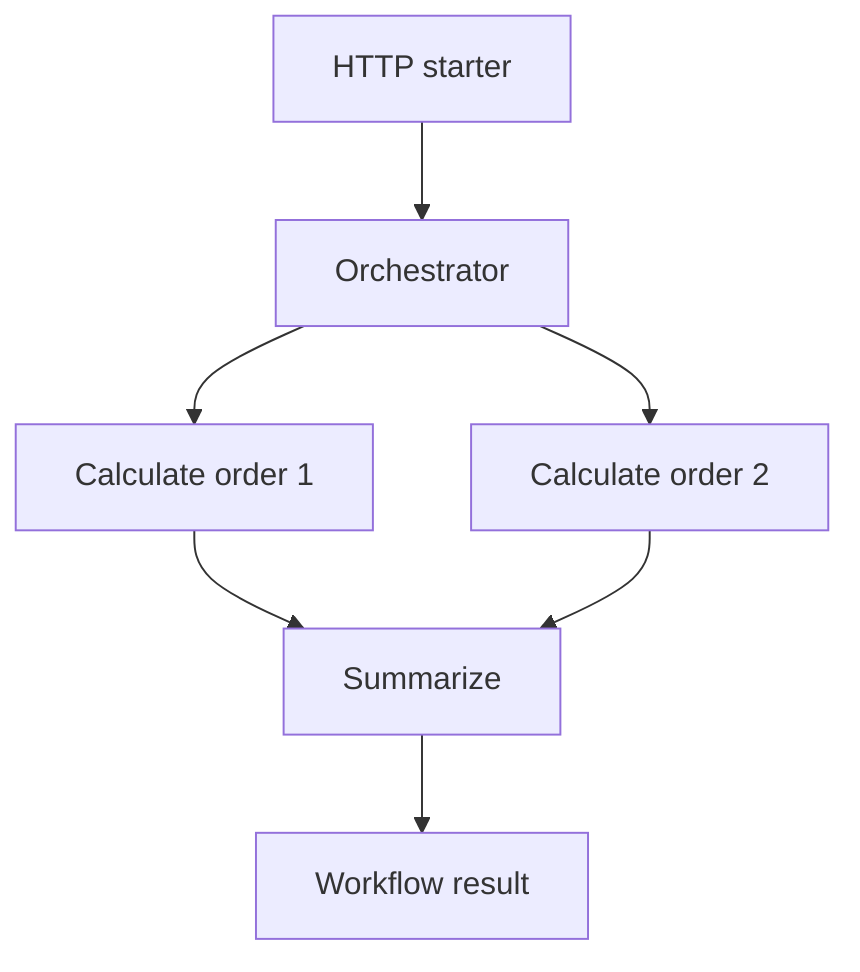

# 10. Durable Functions

## Objective

Coordinate parallel activities and expose workflow status without an Azure account.

Use the separate project under `advanced/durable_app`. Do not add Durable Functions to the beginner app until you understand ordinary triggers.

## Architecture



## Requirements

- Azurite Blob, Queue, and Table services must be running.
- The main project's `.venv` can be reused.
- Azurite Table support is an emulator feature for development. It is not a cloud reliability or performance test.

## Install the Durable dependency

From the repository root:

```powershell
.\.venv\Scripts\python.exe -m pip install `
  -r .\advanced\durable_app\requirements.txt
Copy-Item `
  .\advanced\durable_app\local.settings.json.example `
  .\advanced\durable_app\local.settings.json
```

## Start the Durable project

Stop the beginner Functions host first. Then run:

```powershell
$env:VIRTUAL_ENV = (Resolve-Path .\.venv)
$env:PATH = "$(Resolve-Path .\.venv\Scripts);$env:PATH"
Set-Location .\advanced\durable_app
func start
```

## Start an orchestration

From a second terminal at the repository root:

```powershell
$body = Get-Content .\advanced\durable_app\orders.json -Raw
$response = Invoke-RestMethod -Method Post `
  -Uri http://localhost:7071/api/orchestrations/orders `
  -ContentType application/json `
  -Body $body
$response
```

Poll the URL returned in `statusQueryGetUri`:

```powershell
Invoke-RestMethod $response.statusQueryGetUri | ConvertTo-Json -Depth 10
```

Expected final output includes:

```json
{
  "order_count": 2,
  "grand_total_cents": 5500
}
```

## The three Durable roles

| Role | Responsibility |
|---|---|
| Starter | Starts an orchestration and returns management URLs |
| Orchestrator | Describes workflow control flow |
| Activity | Performs normal computation or external I/O |

## Orchestrator restrictions

Durable orchestrators replay. Do not perform ordinary network, filesystem, database, random-number, or current-time operations inside the orchestrator.

Put external I/O in activities. Activities can be retried, so their side effects must still be idempotent.

Use Durable Functions when you need workflow state, fan-out/fan-in, waiting, retry coordination, or long-running status. Do not use them for a single short calculation.

## Exercise

Add a third activity that writes the completed summary to a local Azurite blob. Use the orchestration instance ID in the output path so retries target the same logical result.

## Checkpoint

Explain why calling `datetime.now()` inside a Durable orchestrator can make replay nondeterministic.
